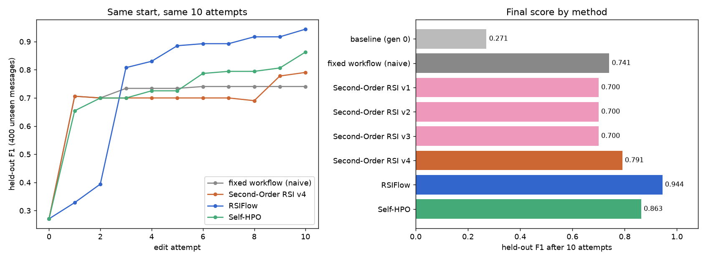

# autodidact-rsi

**A PII redactor that improves itself.** A Gemini model repeatedly rewrites a rule-based Python program that finds personal data (names, emails, phones, card numbers, SSNs, addresses) in customer-support messages. Three recent **recursive self-improvement (RSI)** methods control *how* that rewriting happens, and each one is built, run and measured on the same problem.

Starting point: a weak redactor with **27% F1**. After 10 AI-proposed edits, the best method reaches **94% F1** on 400 messages the AI never saw. Total API cost for every experiment in this repo: **$0.63**.



| Method (10 edit attempts each, same start) | Edits kept | Held-out F1 | Recall |
|---|---|---|---|
| Starting program (generation 0) | – | 0.271 | 0.178 |
| Fixed workflow ("fix the worst label", first-order) | 4/10 | 0.741 | 0.670 |
| Second-Order RSI, first design (v1) | 2/10 | 0.700 | 0.684 |
| Second-Order RSI, final design (v4) | 5/10 | 0.791 | 0.694 |
| **RSIFlow** (meta-agent routes work to the bottleneck) | **8/10** | **0.944** | **0.969** |
| Self-HPO (alternates harness and policy optimization) | 7/10 | 0.863 | 0.860 |

Budget RSI answers a different question (how much *evaluation* it takes to choose an edit): it reached **0.817 F1 with 384 evaluations**, while a search that evaluates every candidate spent 480 evaluations to get its first 0.658.

These are single runs on a laptop with a small model, so treat the gaps as indications rather than proof. The [limitations](#limitations-and-honest-caveats) section covers what they do and don't show.

---

## The problem: PII redaction

Companies keep customer-support chats in locked-down storage. Before a copy of a chat can go to analytics, AI tools or outside vendors, the personal information has to be found and masked:

```
Before: Hi, I'm Sarah Chen. Call me at (408) 555-0199, my order number is 467-683-9760.
After:  Hi, I'm [NAME]. Call me at [PHONE], my order number is 467-683-9760.
```

The hard part is finding PII without over-redacting things that only look like PII. An order number such as `467-683-9760` has exactly the shape of a phone number, and a part number such as `171-07-6651` has exactly the shape of an SSN. A looser pattern catches more phones but also hides order numbers, so precision and recall pull against each other. That conflict is what the RSI methods have to work through.

**Data.** 610 synthetic messages built with [Faker](https://faker.readthedocs.io), so no real personal data is involved and every PII span has an exact answer key. The messages include hard formats (`sarah [at] gmail [dot] com`, `+91 98765 43210`, lowercase names, addresses split across lines) and decoys (order, tracking and part numbers, product names). There are three splits:

| Split | Size | Role |
|---|---|---|
| feedback | 150 msgs | Gemini sees its mistakes on these |
| steering | 60 msgs | small and cheap; decides whether an edit is kept |
| held-out | 400 msgs | never shown to Gemini; all reported scores |

**Score.** A predicted span counts as correct if it has the right label and covers at least 80% of the true span; a half-redacted card number counts as a leak. Reported metrics are precision, recall, F1 and leak rate ([pii_bench/metrics.py](pii_bench/metrics.py)).

## What "recursive self-improvement" means here

```
current program → Gemini proposes an edit → test it → keep it if better → repeat
```

That loop is *self-improvement*. It becomes **recursive** when the system also improves the way it improves: how it chooses edits, how it diagnoses failures, and what workflow and feedback it uses. The three methods change different parts of that loop. They come from Section 10 ("Read and Rebuild October 2026 Research") of the course repo [dlmastery/simple-coding-harness](https://github.com/dlmastery/simple-coding-harness/tree/main/10_research_studio):

| Method | Labs | What it improves |
|---|---|---|
| [**Budget RSI**](labs/01_budget_rsi/README.md) (arXiv:2610.29121) | 10.03–10.05 | **Selection cost**: predicts which edit is best *before* running it |
| [**Second-Order RSI**](labs/02_second_order_rsi/README.md) (arXiv:2610.05701) | 10.06–10.08 | **Reasoning about failure**: detects when it is stuck and diagnoses *why* |
| [**RSIFlow + Self-HPO**](labs/03_adaptive_workflows/README.md) (arXiv:2610.21791, 2610.22791) | 10.12–10.14 | **The process itself**: re-routes the workflow and rewrites its own harness |

## Key findings

1. **The paper's generic edit features did not transfer** (Budget RSI, labs 10.03–10.04). A readout built on code-diff shape picked worse edits than random (rank correlation −0.31). The cause is confounding: big edits happened early, when the program was weak, so the model learned "big edit = low score". Predicting the *gain* with two task-aware features fixed this (+0.28 correlation, better than random, with zero evaluations per candidate). The 60-message steering split turned out to be an excellent proxy for the 400-message held-out split.
2. **A correct diagnosis is not enough** (Second-Order RSI, labs 10.06–10.08). Every probe found the real symptom (`I'm <<talking about>>` captured as a name; order numbers matched as phones), but the small model always answered "keep patching" and proposed rules that broke other cases. The first three designs lost to the naive loop. What helped was falsifying rules that failed twice and escalating to *park the label* in plain code. That is v4, the only version that beat naive.
3. **Splitting misses from false alarms matters most** (RSIFlow, lab 10.13). The meta-agent added a *recall-hunter* node and a *precision-guard* node and routed between them. Every PII type ended above 0.91 F1.
4. **Letting the model shape its own feedback helps** (Self-HPO, lab 10.14). Gemini enlarged its failure sample, grouped it by label and wrote 8 new labeled test messages, some containing trap order numbers.

## Run it

Python 3.13 recommended.

```bash
python3.13 -m venv .venv && source .venv/bin/activate
pip install -r requirements.txt
pytest -q                                   # 12 fast checks, no API calls
```

**Replay everything for free (no API key needed).** Every Gemini response is cached in [llm_cache/](llm_cache/), so every lab reproduces exactly:

```bash
export LLM_OFFLINE=1                        # makes any real API call impossible
python labs/lab_00_problem.py
python labs/01_budget_rsi/lab_10_03_edit_pool.py
python labs/01_budget_rsi/lab_10_04_readout_analysis.py
python labs/01_budget_rsi/lab_10_05_budget_loop.py
python labs/02_second_order_rsi/lab_10_06_naive_vs_sorsi.py          # v4; add --version 1|2|3
python labs/02_second_order_rsi/lab_10_07_probe_analysis.py
python labs/02_second_order_rsi/lab_10_08_debug_session.py
python labs/03_adaptive_workflows/lab_10_12_workflow_profile.py
python labs/03_adaptive_workflows/lab_10_13_rsiflow.py
python labs/03_adaptive_workflows/lab_10_14_self_hpo.py
python labs/summary.py
```

**Run live with your own key.** Copy `.env.example` to `.env` and set `GEMINI_API_KEY`. The model defaults to `gemini-3.5-flash-lite` and can be changed with `GEMINI_MODEL`. A hard spending cap (`LLM_BUDGET_USD`, default $1.00) is checked before every paid call, against all spending recorded in [runs/cost_ledger.jsonl](runs/cost_ledger.jsonl).

## Labs

| Lab | Script | What it shows | Live cost |
|---|---|---|---|
| 00 | [lab_00_problem.py](labs/lab_00_problem.py) | the data, the answer key, the weak starting program | $0 |
| 10.03 | [lab_10_03_edit_pool.py](labs/01_budget_rsi/lab_10_03_edit_pool.py) | 48 real Gemini edits; oracle vs steering vs readout vs random selection | $0.21 |
| 10.04 | [lab_10_04_readout_analysis.py](labs/01_budget_rsi/lab_10_04_readout_analysis.py) | coefficients, the confounding, 8 vs 4 features, training-size curve | $0 |
| 10.05 | [lab_10_05_budget_loop.py](labs/01_budget_rsi/lab_10_05_budget_loop.py) | task-aware readout and a live Budget RSI loop | $0.13 |
| 10.06 | [lab_10_06_naive_vs_sorsi.py](labs/02_second_order_rsi/lab_10_06_naive_vs_sorsi.py) | naive vs SO-RSI, four versions with a post-mortem | $0.19 |
| 10.07 | [lab_10_07_probe_analysis.py](labs/02_second_order_rsi/lab_10_07_probe_analysis.py) | every anomaly and probe: root cause, rule, outcome | $0 |
| 10.08 | [lab_10_08_debug_session.py](labs/02_second_order_rsi/lab_10_08_debug_session.py) | phone vs order-number unit test, a retrospective and one probe | $0.01 |
| 10.12 | [lab_10_12_workflow_profile.py](labs/03_adaptive_workflows/lab_10_12_workflow_profile.py) | profiles the workflow's bottlenecks and maps them to RSIFlow / Self-HPO | $0 |
| 10.13 | [lab_10_13_rsiflow.py](labs/03_adaptive_workflows/lab_10_13_rsiflow.py) | meta-agent routing and workflow evolution | $0.04 |
| 10.14 | [lab_10_14_self_hpo.py](labs/03_adaptive_workflows/lab_10_14_self_hpo.py) | alternating harness (H) and policy (P) steps, self-written tests | $0.05 |
| – | [summary.py](labs/summary.py) | one comparison chart and the spend per lab | $0 |

## Repository layout

```
pii_bench/              shared engine used by every lab
  generator.py          synthetic messages + gold spans + decoys
  metrics.py            span matching → precision / recall / F1 / leak rate
  sandbox.py            runs untrusted LLM-written code safely
  llm.py                Gemini client: response cache, cost ledger, hard budget cap
  editing.py            edit prompt, code extraction, 8 diff features
  budget.py             Budget RSI linear readout + task-aware features
  sorsi.py              anomaly detector, diagnostic probe, inquiry memory
  baseline_redactor.py  generation 0
labs/                   one script per codelab (see table above)
runs/                   every result: JSON traces, final programs, charts
llm_cache/              cached Gemini responses (exact replay, $0)
data/                   the generated splits
tests/                  unit tests for the foundation
```

## Safety

Gemini-written code is untrusted. [pii_bench/sandbox.py](pii_bench/sandbox.py) parses it first and rejects anything outside a small allow-list: only text modules may be imported, and `open`, `exec`, `eval` and dunder access are refused. Code that passes runs in a separate `python -I` process with a timeout, a 1 GB memory cap, an empty working directory and no API key in its environment.

## Limitations and honest caveats

- **Single runs, small samples.** Each comparison is one run of 10 attempts. With a different random seed the ranking could change, especially between close results such as naive (0.741) and SO-RSI v4 (0.791).
- **SO-RSI was redesigned after seeing results.** Versions 1–3 lost to naive; v4 adds an escalation rule taken from the course's own lab 10.07 answer key. All four versions are kept and reproducible so the full path is visible, but v4 was not fixed in advance.
- **RSIFlow's gain is probably mostly its node types.** The meta-agent only ever routed to the recall-hunter and precision-guard nodes. A fixed alternation between those two nodes is the obvious ablation and has not been run.
- **Budget RSI's cost unit is message-evaluations.** Our evaluations are cheap regex runs. In production the expensive evaluation would be human review of redactions, which is the setting the method is designed for.
- **Self-written tests are checked for format, not truth.** Lab 10.14 verifies that every PII value occurs in its message but not that its label is right; one self-written test labels a company support address as personal email.
- **F1 treats a leak and an over-redaction equally.** For privacy, a missed phone number is worse than a masked order number. Lab 10.08 shows a fix that removed a false alarm but leaked a phone, and F1 rejected it only narrowly.
- **Synthetic data has synthetic quirks** (for example "my son Tiffany ..."). Real support text is messier.

## Course reference

Built for the RSI lecture assignment: implement the Section 10 codelabs of [dlmastery/simple-coding-harness](https://github.com/dlmastery/simple-coding-harness) on a problem of my own choosing. The course's laptop demos use synthetic edits and traces; every edit, probe and harness change here comes from a real model working on a real program.
